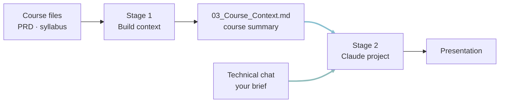
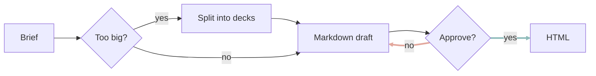

# Presentation Builder — Debuggeando Ideas

Turn a short idea into a teaching presentation with the same style every time.

> **What goes into Claude?** Everything inside **`2-presentation-project/`**: `00_Project_Instructions.txt` as project instructions + `01`, `02`, `03` as project knowledge.

---

## The big picture



| Piece | Answers | Comes from |
|---|---|---|
| `03_Course_Context.md` | What the course is: business case, stack, philosophy | Stage 1, once per course |
| **Brief** | What THIS presentation explains, how deep, which analogies | Your technical chat, every time |
| `01` + `02` | How to build and how to teach | Fixed |

---

## Folder map

```
presentation-builder/
├── README.md                          ← you are here (human)
├── 1-build-context/
│   └── course-context-builder.md      ← prompt, paste in a chat
└── 2-presentation-project/            ← THIS goes into Claude
    ├── 00_Project_Instructions.txt    ← paste in "Project instructions"
    ├── 01_Tech_Engine.md              ← fixed: never edit
    ├── 02_Pedagogy_Style.md           ← fixed: never edit
    └── 03_Course_Context.md           ← REPLACE with Stage 1 output
```

---

## Stage 1 — Summarize the course (once per course)

1. Open a **new Claude chat**.
2. Paste `course-context-builder.md`.
3. Attach your course files (PRD, syllabus, notes). Say **"listo"**.
4. Confirm the detected language (e.g. `es-419`) and answer up to 5 questions.
5. Fix every `[VERIFY]` item. Expected size: **8–15 KB**.

> ⚠️ **Copy the output into `2-presentation-project/03_Course_Context.md`** (replace the placeholder).

---

## Stage 2 — Make a presentation (each time you need one)

**Setup (once per course)**

1. Create a **Claude project**.
2. Paste `00_Project_Instructions.txt` into **Project instructions**.
3. Upload `01`, `02` and `03` as **project knowledge**.

**Each presentation**



| Phase | Claude uses | You do |
|---|---|---|
| 0 · Split (only if > ~16 slides) | Brief | Approve the list of decks |
| 1 · Draft | Brief + `03` (cross-check) + `02` (how to teach) | Approve the Markdown |
| 2 · HTML | `01` (template + components) | Present it |

1. Shape the idea in your **technical chat**.
2. Paste the brief into a new chat in the project.
3. Approve with **"aprobado"**, and you get the HTML.

> `03` is only a technical backup. Internal IDs (T1, T2…, branches, open items) are ignored and never reach the slides.

**A good brief says:** topic · what to explain in depth · analogies you want · what to leave out.

> *Example:* "MCP explained simply. Problem: banks rarely allow the official Jira MCP. Solution: your own MCP with a personal token that defines what it can and cannot do. Analogy: MCP is like a REST API, but for AIs. Split: what a tool can do vs. what it cannot."

---

## What each file does

| File | Role | Answers | Edit? |
|---|---|---|---|
| `course-context-builder.md` | 🟨 Builder | How to summarize a course | Rarely |
| `00_Project_Instructions.txt` | 🟪 Prompt | How Claude behaves in the project | Rarely |
| `01_Tech_Engine.md` | 🟦 Rule | **How** to build the HTML | Never |
| `02_Pedagogy_Style.md` | 🟦 Rule | **How** to teach | Never |
| `03_Course_Context.md` | 🟥 Output | **What** the course is | Per course |

---

## Framework rules

| If the file is… | It is for… |
|---|---|
| `README*` | Humans. Never upload to Claude. |
| `*.md` numbered (`01_`–`03_`) | Claude, as project knowledge. |
| `*.txt` | Claude, pasted into **Project instructions**. |
| `*-builder.md` | Claude, pasted into a one-time chat. |

---

## Something went wrong?

| Symptom | Fix |
|---|---|
| Claude says the context is missing | You uploaded the placeholder `03`. Run Stage 1. |
| Wrong language or tone | Fix `Deck language` in `03`, section B. |
| Wrong version or name | Fix it in `03`. Never in `01`/`02`. |
| Presentation too shallow or off-topic | Improve the **brief**, not the files. |
| New course | Run Stage 1 again. `01` and `02` stay the same. |